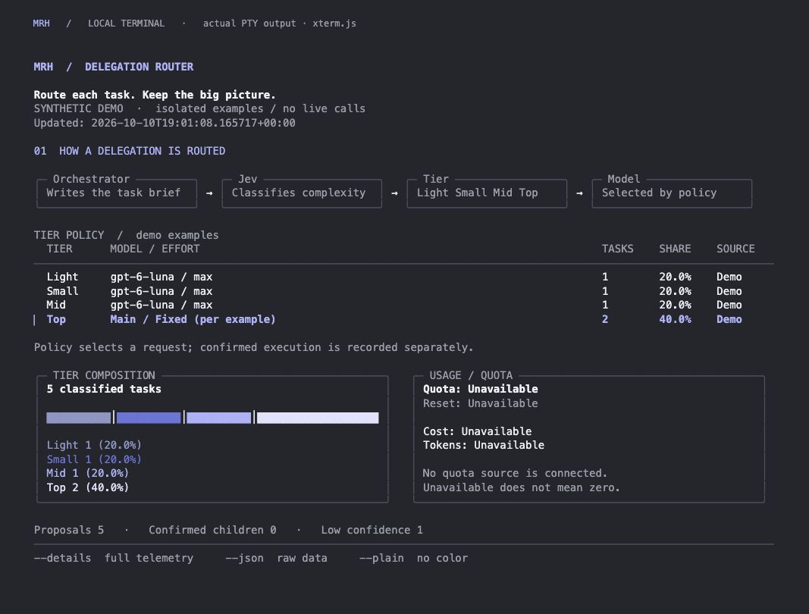

# CLI visual candidate — 2026-10-11

A implemented the user's direct request to approach the supplied reference within a terminal: graphite canvas, lavender emphasis, compact identity, four-stage routing diagram, tier/policy table with Top emphasis, and composition plus usage panels. At narrow widths the flow, policy rows and panels stack. This is command output, not a full-screen interactive TUI. `stats` and `status` use the dashboard by default; `--details` retains the full previous telemetry report, and `--json` retains the Store object without presentation fields.

## Run

```sh
/Users/shawn/Code/model-routing-harness/demo --color --width 120
/Users/shawn/Code/model-routing-harness/demo --plain --width 56
/Users/shawn/Code/model-routing-harness/demo --details
```

The launcher requires Python 3.11+ and no third-party Python packages. Without `--db`, demo writes five existing synthetic examples into a fresh TemporaryDirectory and removes it before rendering. An explicit `--db` retains the previous synthetic-partition behavior. It never calls a provider or modifies Hook settings.

The table in demo displays the actual fixture policy, clearly labeled demo. Top examples cover Main and Fixed. Ordinary stats has no configuration reader and explicitly says configuration is not loaded; it cannot pretend event history establishes current settings. Counts are taken from Store.stats; no reference-image numbers/prices are copied. Quota, reset, cost and child tokens stay unavailable when there is no data. Full Jev estimates/source dates, actual model evidence, outcomes and anomalies remain accessible with `--details`/`--json`.

## Actual terminal evidence



[56-column terminal](evidence/cli-demo-narrow.jpg) preserves policy values in stacked rows and wraps explanations/footer. The parent visually inspected both final screenshots.

Capture used a real POSIX pseudo-terminal (`pty.openpty`, `TIOCSWINSZ`) executing the repository's `demo --color --width 120` and `--width 56`. Its unmodified byte output was rendered by the npm `@xterm/xterm` 5.5.0 terminal emulator (package shasum `275fb8f6e14afa6e8a0c05d4ebc94523ff775396`) in a local browser. Screenshot API captured the emulator directly. A temporary loopback-only HTTP wrapper supplied those PTY bytes; it was not a second product dashboard, and no raster/HTML reconstruction of the CLI was used. Menlo 14px, line height 1.18, true-color ANSI; native terminal font/profile differences remain expected.

The computer-use tool refused access to `com.apple.Terminal` and `com.openai.codex`. Those restrictions were respected; native macOS Terminal/Desktop rendering is not claimed. Screenshots establish the terminal-emulator output, not native app adoption, live provider calls, real quota or completion of Hook integration. The human subsequently accepted this visual direction and requested continuation using it. This does not establish native macOS Terminal rendering.

## Focused checks

- `PYTHONPATH=src python3 -m unittest discover -s tests -p 'test_cli.py' -v`: 18 passing. Includes temporary demo isolation, raw JSON preservation, Hook stdout protocol, sanitized display and 24/28/48/80/100/120/140-column bounds with/without color and wide Unicode input.
- `PYTHONPATH=src python3 -m unittest discover -s tests -p 'test_terminal_provider.py' -v`: 4 passing. Existing detailed-report checks preserve requested vs actual model evidence, Jev telemetry, unknown fields and composition semantics.
- Direct launcher execution and PTY capture succeeded. Parent review only. No full core/provider suite, packaging rebuild, external API, formal Hook activation or Monitor change was needed for this presentation scope.

B continues E8 Hook integration independently. The latest human pause threshold is remaining account quota **below 7%**, at a natural saved checkpoint. The current visual work does not alter routing rules, account settings or reset/reserve usage.
