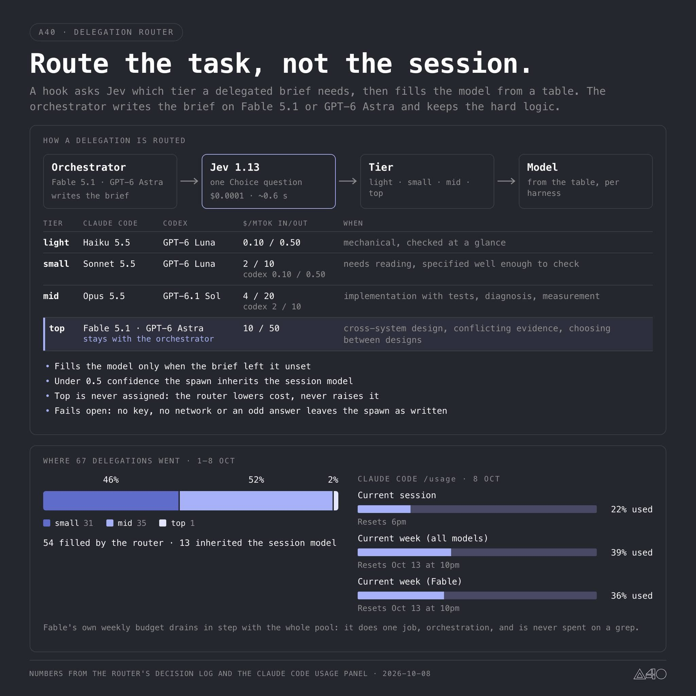

# CLI visual correction — user reference R1

The human rejected the existing CLI demo's appearance and supplied this image directly on 2026-10-11 (Asia/Taipei), requesting closer visual fidelity and discussion with the original GPT. This reopens the S3 **visual presentation** acceptance only; existing fact/statistics/JSON guarantees remain accepted. The image is another creator's work supplied as a reference, not an MRH screenshot or actual MRH data. The original attachment is preserved; this is an unchanged local reference copy, not a recreated image or a publication permission.

Reference SHA256: `c78f15adffcbf3b8e7fc5a8ef63dcbb2ed55bf36e9225ca9541c603a15b1ea26`.

## Confirmed direction and evidence

A directly inspected R1. Original GPT D5 in chat `6ac87fe7-da4c-83ec-8081-19b331292214`, turn `4ad88938-3322-4490-922a-505cd5c90935`, reply `88fc5171-c3eb-4bb2-bb33-08a1d0be4cf6`, reports reopening the original attachments and confirms the CLI/Monitor division. Its R2 was a generated concept, not the original author's product or a replacement for this newly supplied R1. A has not retrieved R2 or the GPT-container zip and does not claim to have seen them.

R1 is a static explanatory infographic. Its typography alone cannot establish whether the original creator used a browser, desktop app or terminal, and it does not establish interaction, automatic refresh or keyboard shortcuts. Honor original REQUIREMENTS section 7: professional MRH terminal presentation; graphical UI belongs to Canopy-Task-Monitor. This correction does not authorize a second MRH web dashboard or modifications to Monitor. It does not require another general requirements interview.

## Presentation to carry into CLI

- Graphite/dark background, white primary and muted gray secondary text, restrained blue-violet/lavender highlights, thin borders, deliberate whitespace and aligned monospaced text. Terminal font/background compatibility must be documented; do not promise pixel-identical poster typography.
- A compact identity/header, period, data state and updated time; then the four-stage flow (main agent → Jev → tier → configured model) and a readable tier/configuration table. Top Main/Fixed retains the actual MRH policy rather than copying the reference's different Top rule.
- At an appropriate wide terminal size, show composition and quota as adjacent panels. The main composition graph is one continuous segmented bar, with percentages, counts and legend. Adapt to stacked panels on narrow terminals. Quota is separate per source/window, with reset time where known; unavailable is not zero.
- Keep primary counters and result summary visible; detailed reason codes and telemetry remain accessible without dominating the default view. Configured/requested models are distinct from confirmed execution. Reference prices, model labels, counts and usage percentages are never copied as MRH facts.

The current renderer ALREADY has one segmented glyph/ANSI bar. GPT D5's suggestion that it has four independent bars was based on a mistaken interpretation; A sent this correction back successfully. The actual deficits are composition, visual hierarchy, panels/columns, table, restrained emphasis and visible rendering evidence. Do not add redundant charts or alter statistics to repair appearance.

## Acceptance and sequencing

Compare actual rendered terminal output against R1 at a representative wide size and a narrow size. Retain a genuine terminal screenshot or recording for visible acceptance; plain text, JSON and passing unit checks cannot alone accept the visual result. Show both clearly labeled synthetic data and unavailable fields without fabricated values. No full-screen TUI, shortcuts, animation, refresh interval, standalone app or new data collection was requested by the image alone.

B continues the already assigned E8 Hook integration. This reference/design correction is recorded for the next presentation work package, not an instruction to interrupt or silently expand E8. The subsequent human instruction authorized A to implement CLI presentation in parallel with B's Hook package, and replaced the quota threshold with below 7%. A has now implemented and visually checked the candidate; see [visual proof](cli-visual-proof.md). This does not accept the full MRH objective or claim Hook activation. User visual acceptance remains pending.
